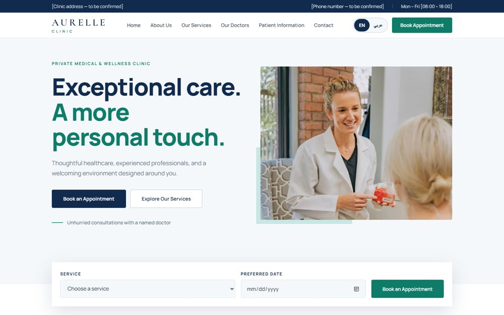
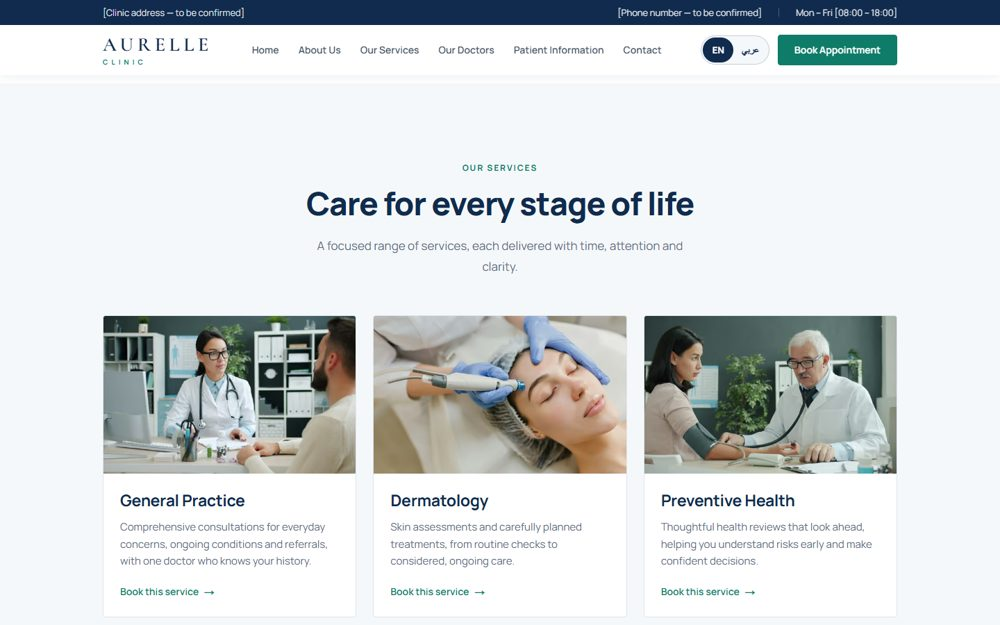
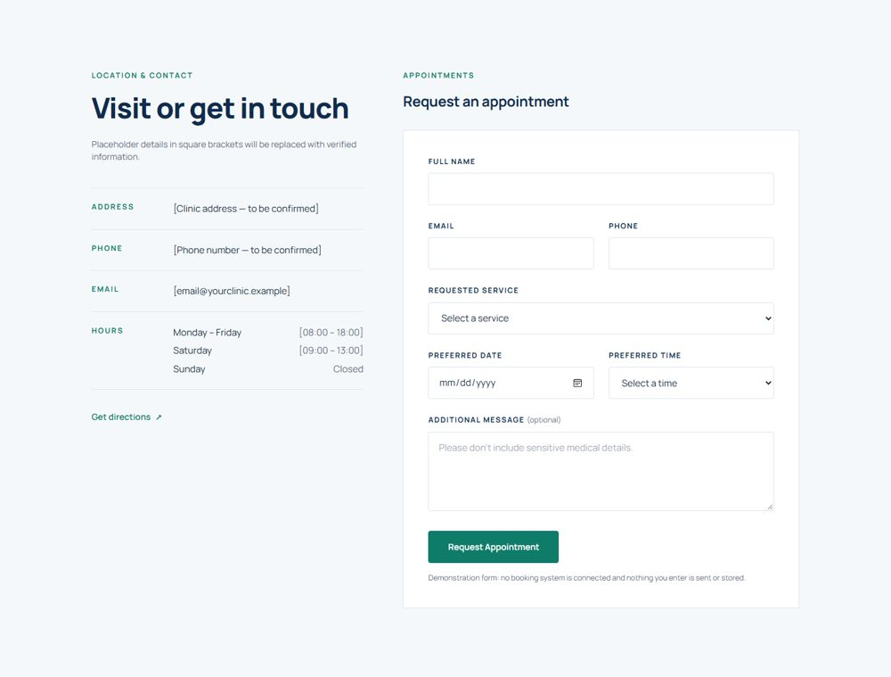
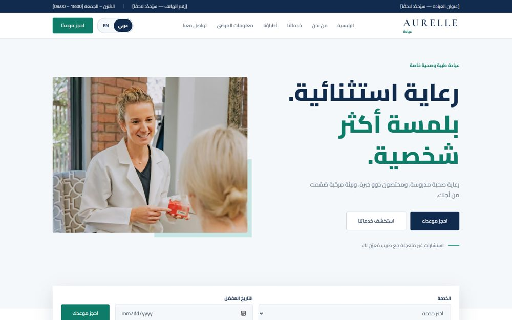
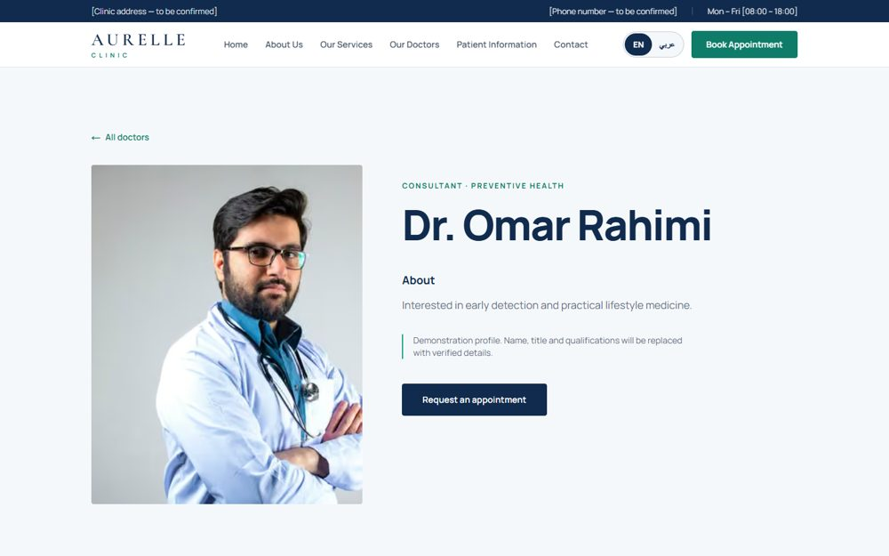
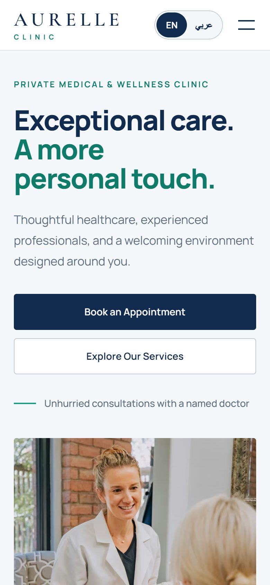
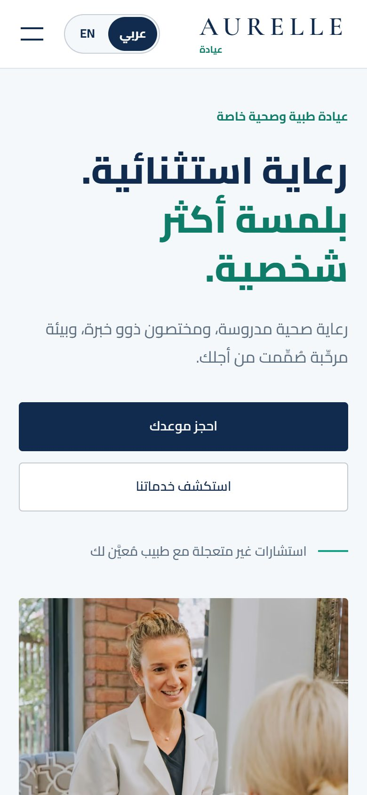
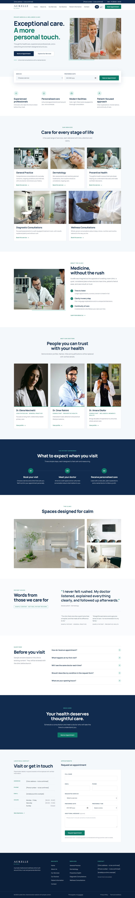

# Aurelle Clinic

A premium, bilingual (**English / Arabic with full RTL**) website for a private medical and wellness clinic, built with **Next.js (App Router), TypeScript and Tailwind CSS**.

> **Demonstration project.** All clinic details (address, phone, email, hours), doctor profiles and testimonials are clearly marked **sample content**. The appointment form has **no backend**: it validates input, then states plainly that nothing was sent, stored or confirmed.



## Features

- **Bilingual with a language toggle**: `EN | عربي` switch in the header. English at `/en`, Arabic at `/ar`, with full right-to-left layout, Arabic typography (Cairo) and a translated form, validation and success messages. Switching keeps you on the same page.
- **Complete home page**: hero with quick-booking strip, trust highlights, services, about, doctors, patient experience, clinic gallery, testimonials, FAQ, appointment CTA, contact and footer.
- **Appointment request form**: labelled fields, inline validation with helpful errors, loading and success states, and prefill from the service cards and the hero booking strip. Honest demo behaviour: no fake confirmations.
- **Doctor profile pages**: `/[lang]/doctors/[slug]`, statically generated for each language.
- **Real photography** (Unsplash) with responsive cropping, `next/image` optimisation and lazy loading below the fold.
- **Accessible by design**: semantic HTML, skip link, visible focus states, keyboard-operable menu (Escape closes it), native `<details>` FAQ, `aria` labels, reduced-motion support.
- **Restrained motion**: subtle fade-and-rise entrances and hover zooms only; all disabled for `prefers-reduced-motion`.
- **Responsive**: designed separately for desktop, tablet and mobile, with no horizontal overflow.
- **Fully static**: every page is prerendered at build time.

## Screenshots

| | |
|---|---|
|  |  |
| **Services**: image cards that prefill the booking form | **Appointment form** with contact details |
|  |  |
| **Arabic (RTL)**: mirrored layout and Arabic font | **Doctor profile** page |

| Mobile (English) | Mobile (Arabic, RTL) |
|---|---|
|  |  |

<details>
<summary>Full page (English)</summary>



</details>

## Tech stack

| Area | Choice |
|---|---|
| Framework | [Next.js](https://nextjs.org) 16 (App Router, static generation) |
| UI | React 19, TypeScript |
| Styling | Tailwind CSS 4 (design tokens in `app/globals.css`) |
| Fonts | `next/font`: Manrope, Cormorant Garamond (wordmark), Cairo (Arabic) |
| i18n | Lightweight route-based (`/en`, `/ar`) with typed dictionaries, no i18n library |
| Images | `next/image` (AVIF/WebP), photos from [Unsplash](https://unsplash.com) |

No UI kit, animation library or form library: motion is CSS, validation is a small typed function.

## Getting started

Requires **Node.js 20.9+**.

```bash
git clone https://github.com/Usman552/Clinic-Website.git
cd Clinic-Website
npm install
npm run dev
```

Open <http://localhost:3000>. It redirects to `/en`; the Arabic site is at <http://localhost:3000/ar>.

```bash
npm run build   # production build
npm start       # serve the production build
```

## Project structure

```
app/
  [lang]/                 # /en and /ar
    layout.tsx            # <html lang dir>, fonts, nav, footer
    page.tsx              # home page sections
    doctors/[slug]/       # doctor profile pages
    privacy/  terms/      # placeholder legal pages
  globals.css             # design tokens, type scale, RTL/Arabic rules
components/               # Nav, Hero, QuickBook, Services, Doctors, Faq, BookingForm, ...
lib/
  i18n.ts                 # locales, direction, link helper
  dictionaries/en.ts      # all English content and UI strings (source of truth for types)
  dictionaries/ar.ts      # Arabic translation (must match en.ts shape)
public/images/            # photography
docs/screenshots/         # README images
```

## Customising

- **Content and translations**: edit `lib/dictionaries/en.ts` and `ar.ts`. The Arabic file is type-checked against the English shape, so a missing key fails the build.
- **Replace sample data** with verified information before launch: contact details, doctors and qualifications, testimonials (use only real, permitted reviews), opening hours and the legal pages.
- **Colours and type**: tokens at the top of `app/globals.css` (`navy`, `teal`, `mist`, ...).
- **Real bookings**: the form is in `components/BookingForm.tsx`. Replace the simulated submit with a call to your own API, email service or booking provider.

## Notes

- Arabic copy was written for this demo; have a native speaker review it, especially medical terminology, before launch.
- Photographs are from Unsplash under the [Unsplash License](https://unsplash.com/license). They are stand-ins; use the clinic's own photography in production.
- Doctor portraits are stock photos of models, not real clinicians.

## Topics

`nextjs` `react` `typescript` `tailwindcss` `clinic-website` `healthcare` `medical` `rtl` `arabic` `i18n` `app-router` `responsive-design` `accessibility` `ui-ux`
